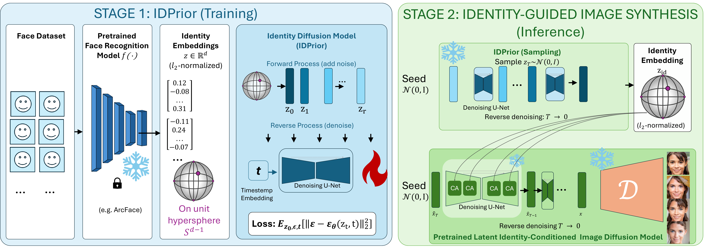

# IDPrior: Decoupling Identity Generation from Facial Image Synthesis




## Official implementation of the paper:

> **IDPrior: Decoupling Identity Generation from Facial Image Synthesis**  
> **Fadi Boutros, Meriç Demirörs, Darian Tomašević, Vitomir Štruc, Naser Damer**


## Abstract

Large-scale identity-labeled face datasets are essential for training modern face recognition models, yet collecting and annotating such data is costly and raises privacy and ethical concerns. Existing synthetic face generation methods typically derive identities from predefined class labels, unconditional image generation, or predefined latent sampling strategies, without explicitly modeling the underlying distribution of facial identities. In this paper, we propose **IDPrior**, a two-stage framework that decouples identity generation from image synthesis. We first learn a diffusion prior in the embedding space of a pretrained face recognition model to model the distribution of facial identities and generate novel identity embeddings. These embeddings are then used to condition a pretrained identity-conditioned diffusion model (DM), enabling the synthesis of multiple images of the same identity. This modular design provides a scalable approach to identity generation while remaining compatible with existing and future identity-conditioned DMs. Experiments indicate that IDPrior generates diverse and well-separated identities while maintaining a closer correspondence to the distribution of authentic identities. Face recognition models trained on datasets generated using IDPrior-generated identities achieve competitive or improved performance compared with existing synthetic-data-based methods across multiple face verification benchmarks.

## Installation

Clone the repository:

```bash
git clone https://github.com/fdbtrs/IDperturb.git
cd IDperturb/IDPrior
```

Note: IDPrior is included as a submodule directory within the IDPerturb repository and does not have a separate GitHub repository.

The code supports diffusion-based identity generation as well as alternative generative approaches based on normalizing flows and variational autoencoders (VAEs).

The code works with Python 3.10.12 and PyTorch 2.14.1.


To install dependencies:

```
pip install -r requirements.txt
```

### 1. Diffusion Models

The diffusion model is implemented as UNet2DModel with 2D matrix input. 512 identity embeddings are reshaped into 16x32 patches.

The training and inference pipeline is managed through **main.py** via given config file.

#### Training:

Create a training configuration using **configs/example_training_config.py** as a template. Specify the model architecture, dataset, hyperparameters. Adjust the configuration parameters according to your dataset and experimental setup.
Start training using:
```bash
CUDA_VISIBLE_DEVICES=<GPU_IDS> torchrun \
    --nproc_per_node=<NUM_GPUS> \
    --nnodes=1 \
    --node_rank=0 \
    main.py <TRAIN_CONFIG_NAME>
```

Use **utils/plot_parsed_training_log.py** to visualize and investigate the training progress.

#### Inference:

Create an inference configuration specifying the model, dataset, hyperparameters. Adjust the paths to the trained model checkpoint.
Run inference using:

```bash
CUDA_VISIBLE_DEVICES=<GPU_IDS> torchrun \
    --nproc_per_node=<NUM_GPUS> \
    --nnodes=1 \
    --node_rank=0 \
    main.py <INFERENCE_CONFIG_NAME>
```

The generated identity embeddings are saved in the corresponding run directory.


### 2. Normalizing Flow Models

IDPrior also supports normalizing flow-based identity generation using the Normalizing Flows implementation.

The normalizing flow model consists of residual networks and operates on 1D identity embedding vectors.

Training and inference are implemented in **train_normalizing_flow_multi_GPU.py**

```bash
CUDA_VISIBLE_DEVICES=<GPU_IDS> \
    NCCL_P2P_DISABLE=1 \
    TORCH_DISTRIBUTED_DEBUG=DETAIL \
    NCCL_DEBUG=INFO torchrun \
    --standalone \
    --nproc_per_node=<NUM_GPUS> \
    train_normalizing_flow_multi_GPU.py \
    --out_folder "OUT/FOLDER/PATH" \
    --run_training True \
    --embeddings_file "PATH/TO/EMBEDDINGS/FILE.npy" \
    *rest of the argumans
```

### 3. Variational Autoencoder (VAE)

An additional identity generation approach is implemented using a variational autoencoder.

The VAE consists of an encoder-decoder architecture with residual blocks and operates on 1D identity embedding vectors.

Training and inference are implemented in **train_VAE_multi_GPU.py**

```bash
CUDA_VISIBLE_DEVICES=<GPU_IDS> \
    NCCL_P2P_DISABLE=1 \
    TORCH_DISTRIBUTED_DEBUG=DETAIL \
    NCCL_DEBUG=INFO torchrun \
    --standalone \
    --nproc_per_node=<NUM_GPUS> \
    train_VAE_multi_GPU.py \
    --out_folder "OUT/FOLDER/PATH" \
    --run_training True \
    --embeddings_file "PATH/TO/EMBEDDINGS/FILE.npy" \
    *rest of the argumans
```


## Evaluation

IDPrior provides several utilities to evaluate the quality, diversity, and distributional properties of generated identity embeddings.

The evaluation pipeline includes identity uniqueness, genuine/imposter similarity distributions, FID-related metrics, training similarity, and identity leakage analysis.


The following steps describe the evaluation workflow:

1. *Calculate identity uniqueness:* Run **utils/calculate_uniqueness_parallel.py** to calculate intermediate statistics required for identity uniqueness evaluation. The script generates intermediate files used for subsequent analysis.

2. *Calculate genuine and imposter similarity distributions:* Run **utils/calculate_genuine_imposter_fast.py** to calculate partial genuine and imposter scores. The resulting text files are used for further metric calculations.

    - Note: The generated files can become very large depending on the number of embeddings and the selected partial calculation settings. Large files may require several hours of processing in the subsequent steps.

3. *Calculate verification metrics:* Use the generated genuine and imposter score files together with the **geteerinf utility from PyEER** to calculate verification metrics. The evaluation produces plots and a CSV report containing the corresponding metrics.

4. *Visualize genuine/imposter metrics:* Use **utils/plot_genuine_imposter_plateau.py** to visualize the genuine and imposter distributions based on the CSV report generated by PyEER.

5. *Calculate FID, training similarity, and identity leakage metrics:* Run **utils/calculate_FID_TrainSim_IDLeak.py** to calculate metrics with respect to a selected reference dataset. The script also generates visualizations of similarities between generated and authentic identity embeddings.

6. *Visualize generated identity similarities:* Run **utils/plot_seperate_images.py** to generate plots illustrating the similarities between pairs of generated identity embeddings.


### Repository Structure

The main implementation is organized as follows:

IDPrior/  
│README copy  
├── configs/  
│   └── example_training_config.py  
│  
├── utils/  
│   ├── calculate_FID_TrainSim_IDLeak.py  
│   ├── calculate_genuine_imposter_fast.py  
│   ├── calculate_uniqueness_parallel.py  
│   ├── merge_outputs.py  
│   ├── metrics.py  
│   ├── plot_genuine_imposter_plateau.py  
│   ├── plot_parsed_training_log.py  
│   ├── plot_seperate_images.py  
│  
├── datasets.py  
├── evaluation_utils.py  
├── helper_functions.py  
├── main.py  
├── models.py  
├── train_normalizing_flow_multi_GPU.py  
├── train_utils.py  
└── train_VAE_multi_GPU.py  

#### Components
- calculate_FID_TrainSim_IDLeak.py: Calculates FID-related, training similarity, and identity leakage metrics.  
- calculate_genuine_imposter_fast.py: Performs partial genuine/imposter similarity calculations to generate inputs for the PyEER library.  
- calculate_uniqueness_parallel.py: Parallelized similarity calculations for large embedding files.  
- merge_outputs.py: Merges diffusion training and inference outputs.  
- metrics.py: Evaluation metrics.  
- plot_genuine_imposter_plateau.py: Calculates and visualizes genuine/imposter metrics using PyEER reports.  
- plot_parsed_training_log.py: Visualizes diffusion model training logs.  
- plot_seperate_images.py: Generates visualizations of similarities between generated identity embedding pairs.  
- datasets.py: Dataset implementations for diffusion models.  
- evaluation_utils.py: Inference and evaluation utilities for diffusion models.  
- helper_functions.py: General helper functions.  
- main.py: Main entry point for diffusion model training and inference.  
- models.py: Diffusion model implementations and utilities.  
- train_normalizing_flow_multi_GPU.py: Training and inference implementation for normalizing flow models.  
- train_utils.py: Training utilities for diffusion models.  
- train_VAE_multi_GPU.py: Training and inference implementation for VAE models.  

## Citation

If you use IDPrior, cite the following paper:

```
@inproceedings{Boutros2026IDPrior,
    author    = {Fadi Boutros and Meriç Demirörs and Darian Tomašević and Vitomir Štruc and Naser Damer},
    title     = {Decoupling Identity Generation from Facial Image Synthesis},
booktitle = {Proceedings of the Winter Conference on Applications of Computer Vision (WACV)},
    month     = {November},
    year      = {2026}

}

```


## License

```
This project is licensed under the terms of the Attribution-NonCommercial-ShareAlike 4.0 
International (CC BY-NC-SA 4.0) license. 
Copyright (c) 2026 Fraunhofer Institute for Computer Graphics Research IGD Darmstadt
```